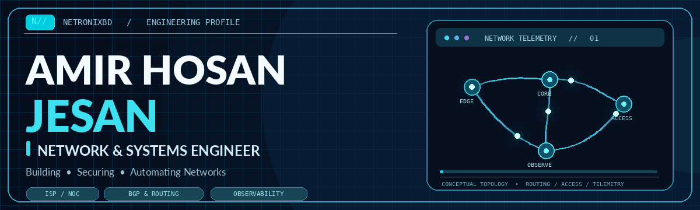
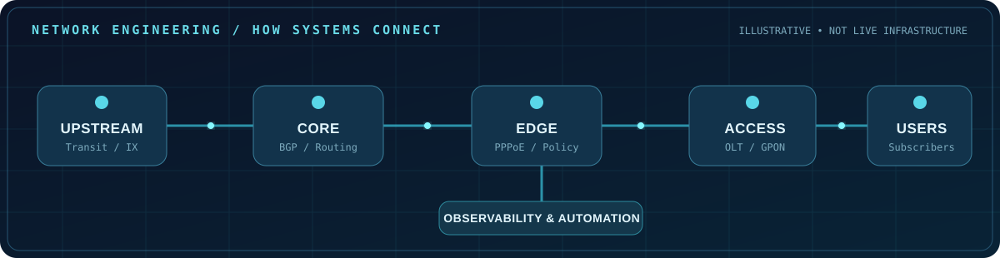

<!--
  NETRONIXBD // GITHUB PROFILE
  Crafted for Amir Hosan Jesan | Updated: November 2026
  This is a GitHub Profile README, not a full HTML website.
  It intentionally avoids custom JS/CSS, which GitHub does not execute in README files.
  Upload this file together with the assets/ folder and .github/workflows/snake.yml.
-->

<!-- HERO -->

  

   

  

  

    
    
    
    
  

  
<b>Bangladesh 🇧🇩 &nbsp; · &nbsp; Network Engineering &nbsp; · &nbsp; Systems & Infrastructure &nbsp; · &nbsp; Automation</b>

  

    
    
    
    
    
    
  

---

## About

**Hello, I'm Amir Hosan Jesan**, also known as **Netronixbd**.

I'm a **Network & Systems Engineer** focused on ISP infrastructure, NOC operations, routing, troubleshooting, and reliable self-hosted systems. My work connects real-world network operations with better monitoring, faster diagnostics, and practical automation.

I enjoy working across the full service path, from **BGP peers and core routers** to **PPPoE subscribers, OLTs, ONUs, optical levels, and operational dashboards**. I believe the best networks are not just fast: they are **observable, maintainable, secure, and easy to troubleshoot**.

<table>
  <tr>
    <td width="50%" valign="top">
      <h3>🎯 Engineering focus</h3>
      
Service-provider networks, routing policy, traffic engineering, subscriber connectivity, and fault isolation.

    </td>
    <td width="50%" valign="top">
      <h3>🛠️ Systems focus</h3>
      
Linux infrastructure, monitoring platforms, self-hosted services, API integrations, and repeatable operational workflows.

    </td>
  </tr>
  <tr>
    <td valign="top">
      <h3>📡 Working style</h3>
      
Collect evidence, verify the path, isolate the cause, make safe changes, and document the outcome.

    </td>
    <td valign="top">
      <h3>⚡ Current interests</h3>
      
Automated NOC diagnostics, end-to-end PPPoE/GPON visibility, infrastructure observability, and network scripting.

    </td>
  </tr>
</table>

## Expertise

  

| Area | Technologies and hands-on interests |
| :-- | :-- |
| **Routing & core** | BGP, IPv4 / IPv6, routing policy, prefix management, VLANs, interconnection, traffic troubleshooting |
| **ISP access** | MikroTik CCR, PPPoE, GPON / EPON, OLT / ONU, optical diagnostics, subscriber mapping |
| **Network platforms** | MikroTik RouterOS, Juniper Junos / MX, Cisco, FortiGate |
| **Monitoring** | Zabbix, LibreNMS, Cacti, Grafana, VictoriaMetrics, SNMP, traffic visibility |
| **Automation & operations** | Python, Bash, REST APIs, Telegram bots, scheduled checks, incident documentation |
| **Systems & hosting** | Linux, Proxmox VE, Docker, Nginx, FastAPI, PostgreSQL, Redis |

## Toolchain

**ROUTING, SWITCHING & SECURITY**

 

**LINUX, INFRASTRUCTURE & DEVELOPMENT**

 

**MONITORING & DATA**

## Featured Work

<table>
  <tr>
    <td width="72%" valign="top">
      <h3><a href="https://github.com/Netronixbd/IP_Prefix_List">🌐 IP Prefix List</a></h3>
      
A public collection of service-specific IP prefix lists and MikroTik-ready routing/address-list resources. Designed as a practical reference for managing and organizing internet-service traffic classifications.

      
    </td>
    <td valign="middle" align="center">
      <b>NETWORK AUTOMATION</b>  
      <code>IP PREFIXES</code>  
      <code>ROUTEROS</code>  
      <code>ROUTING POLICY</code>
    </td>
  </tr>
</table>

  
<b>🔬 What I'm currently building and learning</b>

   
  <ul>
    <li>Faster end-to-end diagnostics across CCR, PPPoE, OLT, and ONU.</li>
    <li>Monitoring dashboards that combine network health with data freshness.</li>
    <li>Automated network checks, reporting, and operational tooling.</li>
    <li>Better documentation and reusable configuration references.</li>
  </ul>

   
  

## GitHub Activity

  
   
  
  
   
  
    
  

### Contribution Flow

  <!-- Generated by .github/workflows/snake.yml. The image appears once that workflow has completed. -->
  <picture>
    <source media="(prefers-color-scheme: dark)" srcset="https://raw.githubusercontent.com/Netronixbd/Netronixbd/output/github-snake-dark.svg" />
    <source media="(prefers-color-scheme: light)" srcset="https://raw.githubusercontent.com/Netronixbd/Netronixbd/output/github-snake.svg" />
    
  </picture>

## Connect

  <h3>Have a networking challenge, an idea, or a project to discuss?</h3>
  
I'm always interested in useful conversations about ISP engineering, routing, monitoring, and network automation.

  
  
  
    
  
   
  <b>© 2026 Amir Hosan Jesan (Netronixbd). All rights reserved.</b>
   
  Original material may be read and referenced. Reposting or redistributing it requires written permission, except where an individual repository's license states otherwise.

